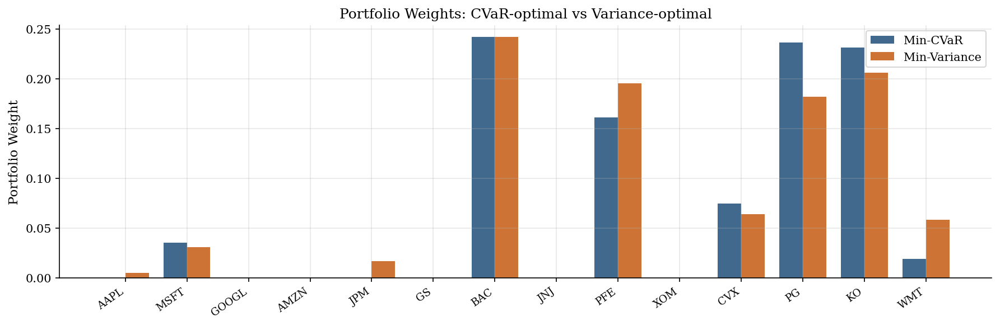

# Conditional Value At Risk
Implementing the Conditional Value At Risk using Convex Analysis

## Motivation
The first technique taught in portfolio optimization is usually Marowitz Minimum Variance. This is obviously bad, as in this framework a portfolio that overperforms is as bad as one that underperforms. As an upside, it is mathematically nice and can be solved basically by differentiating a simple function.  
The next thing is usually Value at Risk (V@R), this is actually used in banks and solves a lot of the practical problems. Mathematically, it is bad: It is not convex, so a lot of nice optimization techniques are no use. It is also not subadditive, which is not only bad for proofs but means that V@R does not really respect diversification.  
A nice solution to this is the Conditional Value at Risk. [cite] shows, that this not only has nice mathematical properties and interpretations, but also works nicely with tail risks.

## Portfolio Weights
The weights for the different stocks are calculated using Convex Analysis, for the Conditional Value at Risk the formulation as a linear program by Rockafeller and Uryasev is used. A sample portfolio from 14 quicky choosen stocks looks like this:

